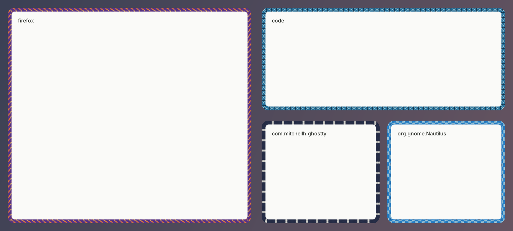

# Window Sweaters for Hyprland

Knitted window borders for [Hyprland](https://hypr.land), with the same sweaters as the macOS app: the same stitches, the same 37 hand-picked app colourways, the same Zigzag, picnic and twinkle sweaters for every other app. 🧶



*Rendered by this plugin's renderer from Linux app ids. It is not a screenshot of a running Hyprland session.*

## How it matches the macOS app

The plugin uses a Cairo port of the macOS renderer (`src/knit.c`, `src/chart.c`, `src/apps.c`, `src/autoyarn.m`). The stitch geometry, the yarn shading, the corner mitres, the cuffs and the colourways are the same code paths, translated from CoreGraphics to Cairo.

To check that the port looks the same, `make compare` renders all 37 catalogue plates the way the macOS project's `tests/render.c --individual` does and compares them with the images in [docs/collection](../docs/collection). The mean difference per colour channel is about 1.5 out of 255 in the window band, and at most 4.2 in the 4x enlarged strip.

## Status

- The renderer, the app matching, the icon colours and the strip rendering the plugin uses are covered by `make test`, which runs here with AddressSanitizer and UBSan.
- The plugin code targets Hyprland **0.57.x**. It was written against the 0.57.1 headers and checked against them by hand, but it has **not** been compiled against an installed Hyprland, or run in a Hyprland session yet. If it fails to build or misbehaves, please open an issue with your Hyprland version (`hyprctl version`).

## Install

You need Hyprland 0.57 with its headers (most distributions ship them with Hyprland, or `hyprpm update` installs them), Cairo, and optionally librsvg (for SVG app icons, which most Linux apps use).

With hyprpm:

```sh
hyprpm add https://github.com/wnhrt/window-sweaters
hyprpm enable window-sweaters
```

Or by hand:

```sh
make -C hyprland
hyprctl plugin load "$PWD/hyprland/window-sweaters.so"
```

Hyprland's own border sits inside the sweater. For the macOS look, turn it off and keep rounded corners:

```ini
general {
    border_size = 0
}
decoration {
    rounding = 10
}
```

## Make yourself cosy

```ini
plugin {
    window-sweaters {
        enabled = true
        pattern = by-app     # by-app, zigzag, stockinette, rib, picnic, ribbon, posy, twinkle, candy-stripe, ...
        width = 12           # 6 slim, 8 narrow, 12 medium, 14 regular, 18 wide, 28 extra wide
        rows = 6             # stitch size: 3 chunky, 6 medium, 10 fine, 14 very fine
        dim = 0              # darken unfocused sweaters, 0..1
        anchor = corner      # where the pattern starts on each side: corner or centre
        basket = wool        # fallback yarns: wool, sorbet, forest, mono, dopamine, neon, punch
        include =            # if set, only these apps wear sweaters
        exclude =            # these apps never do, e.g. kitty, org.gnome.Calculator
    }
}
```

For a Lua config, the same keys should go under `hl.config({ plugin = { ["window-sweaters"] = { ... } } })`, as for other plugins; this has not been tried yet.

**By App** gives each app its own sweater. **Zigzag** gives them all a matching cream zigzag in colours taken from their icons. Colourwork needs at least six rows (or the chart's height), as on macOS.

The menu bar of the macOS app becomes `hyprctl sweaters`:

```sh
hyprctl sweaters                  # what is on right now
hyprctl sweaters list             # every pattern and app sweater
hyprctl sweaters toggle           # also: on, off
hyprctl sweaters pattern zigzag
hyprctl sweaters width 18
hyprctl sweaters rows 10
hyprctl sweaters reload           # re-read apps.conf and the charts folder
hyprctl sweaters reset            # back to the config file's values
```

Changes made with `hyprctl sweaters` last until Hyprland reloads its config. For a keybind:

```ini
bind = SUPER SHIFT, K, exec, hyprctl sweaters toggle
```

To leave a window bare, use the `window-sweaters:off` window rule:

```ini
windowrule {
    name = no-sweater-for-pip
    match:title = ^(Picture-in-Picture)$
    window-sweaters:off = on
}
```

The `decorate` window rule turns sweaters off as well, and fullscreen windows never wear one.

## Which app is which

Sweaters are matched against the window's class (its Wayland app id, see `hyprctl clients`). Names match as case-insensitive prefixes, spaces, dashes and underscores count as the same, and the longest match wins. A reverse-DNS app id is also matched by its last part. So `firefox` and `org.mozilla.firefox` wear Firefox's sweater, `google-chrome` and `chromium` Chrome's, `code` VS Code's, `com.mitchellh.ghostty` Ghostty's.

A few Linux apps borrow a macOS colourway: file managers (Files/Nautilus, Dolphin, Thunar, Nemo, PCManFM) wear Finder's checks, GNOME Terminal and Ptyxis wear Terminal's stripes, `teams-for-linux` wears Teams', VSCodium wears VS Code's.

Every other app takes its colours from its icon: the plugin finds the app's `.desktop` entry, follows its `Icon=` to the icon theme (hicolor first), and samples it in the background, exactly as the macOS app samples app icons. Without a usable icon, an app keeps a stable colour from the fallback basket.

## Your own colourways

```text
~/.config/window-sweaters/apps.conf
~/.config/window-sweaters/charts/
```

A rule looks like this, with the app id on the left:

```text
kitty = #D58561 atelier-claude
```

PNG charts in the charts folder replace built-in patterns of the same name, or add new ones: one pixel per stitch cell, transparent pixels in the app's own yarn. Run `hyprctl sweaters reload` after editing.

## Differences from the macOS app

- The sweater reserves its width around each window, like Hyprland's own border, so tiled windows shrink by it and never overlap. Turning sweaters on or off re-tiles the windows.
- Hyprland moves the sweater in the same frame as the window, so it stays on while you resize, instead of hiding.
- Corners follow `decoration:rounding`; with a `rounding_power` other than 2 the window's corner is a squircle and the sweater's stays round.
- There is no startup script (`sweatersrc`); the plugin's config block and `hyprctl sweaters` take its place.

## Contributing

```sh
make -C hyprland test      # renderer unit tests (Cairo only)
make -C hyprland plates    # render the collection plates into hyprland/build/plates
make -C hyprland compare   # compare them with docs/collection (Python 3, Pillow, NumPy)
```

The renderer is in `core/` (C, Cairo), the plugin in `plugin/` (C++).
